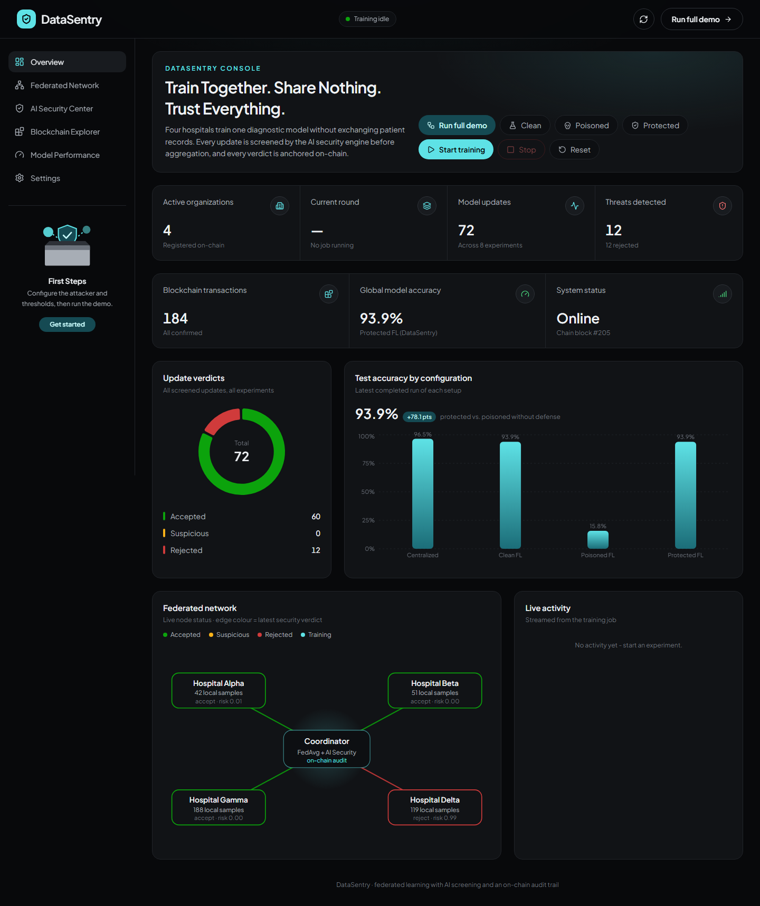
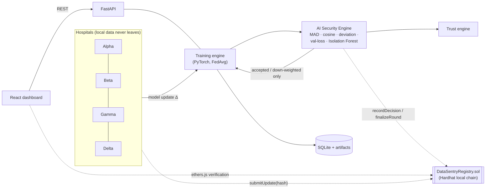
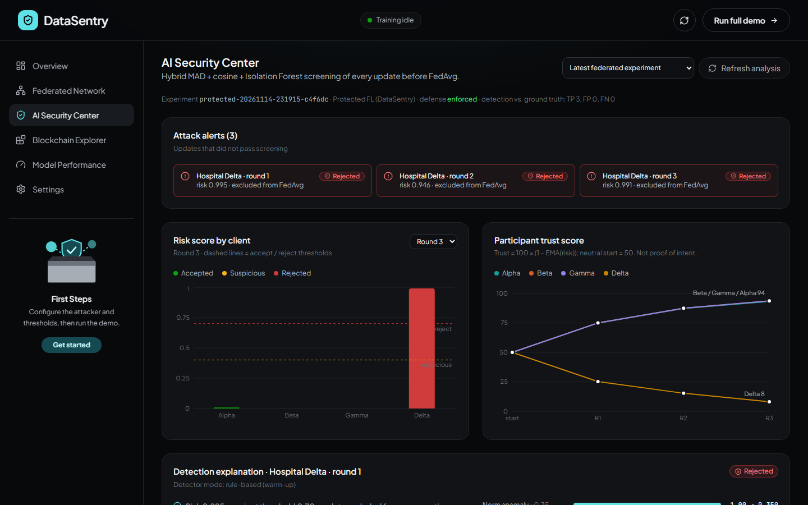
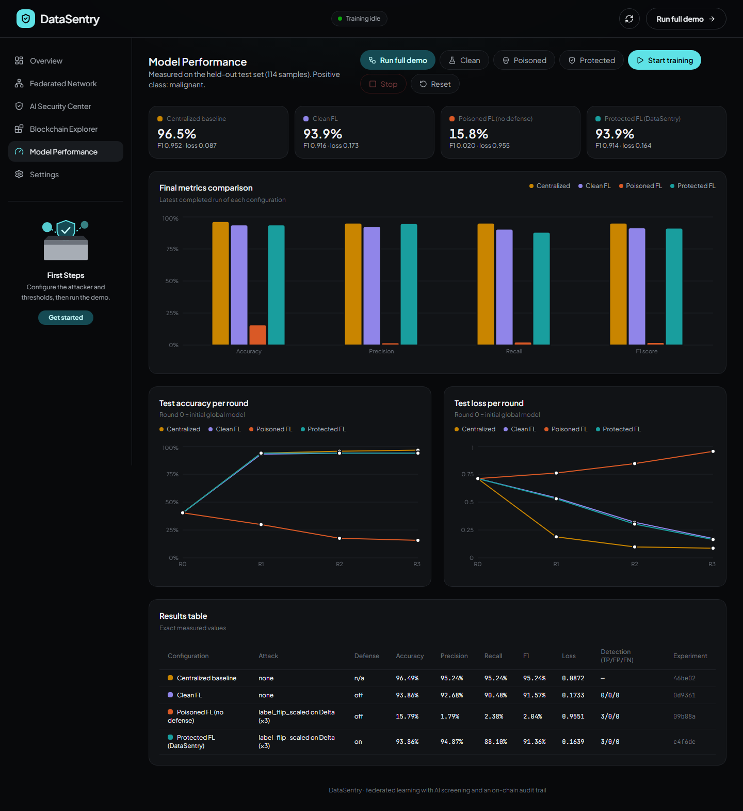
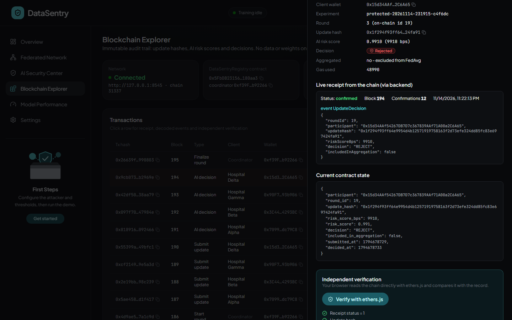

# DataSentry

**Train Together. Share Nothing. Trust Everything.**

DataSentry is a blockchain-protected collaborative AI platform. Four simulated
hospitals jointly train one diagnostic neural network with **federated
learning**: patient records never leave a hospital. Every model update is
screened by an **AI security engine** before aggregation, malicious updates are
excluded, each participant earns a **trust score**, and every update hash,
risk score and decision is anchored in a **Solidity audit trail**.



---

## Problem

Collaborative AI between organisations runs into five problems:

* **Private data sharing.** Hospitals cannot pool patient records.
* **Poisoned updates.** One participant can submit poisoned updates (label flipping, boosted or sign-reversed weights) and destroy the shared model.
* **Accountability.** Participants are not accountable for what they submit.
* **Verifiability.** Nobody can later verify which updates were used to build a model.

## Solution

| Layer | What DataSentry does | What it does *not* claim |
|---|---|---|
| Local data protection | Raw data stays in each client; only weight deltas are sent | FL alone is **not** a privacy guarantee - updates can leak information (no DP / secure aggregation here) |
| Model-update security | Hybrid AI screening (MAD, cosine, deviation, validation impact, Isolation Forest) before FedAvg; REJECTed updates never enter aggregation | Detection is statistical, not proof; a careful low-strength attacker can stay under thresholds |
| Auditability | SHA-256 of every update + risk + decision + global-model hash recorded on-chain with role-based access | The chain proves *what was recorded*, not that the coordinator's off-chain computation was honest |

### Innovation
* **Hybrid, explainable screening.** A rule-based risk formula with plain-language explanations is combined with an Isolation Forest that can only *escalate* an update, never reject it alone.
* **Robust to non-IID data.** Features are relative to the round's peers, and update magnitude is normalised **per optimizer step**, which removes false positives caused by unequal dataset sizes.
* **Separation of duties on-chain.** Each hospital's *own wallet* submits its update hash, and only the coordinator can record verdicts and finalize rounds. When an AI REJECT verdict is aggregated anyway, the chain emits `VerdictOverridden`, so it stays publicly visible.
* **End-to-end verifiability.** Artifact file → recomputed hash → SQLite → contract state, checked by the API and again independently in the browser with ethers.js.

## Architecture



More detail is in [docs/architecture.md](docs/architecture.md).

## Technology stack
* **Frontend:** React 19, Vite 8, Tailwind CSS 4, Recharts, React Router, Axios, Ethers.js 6, Lucide.
* **Backend:** Python 3.11, FastAPI, Uvicorn, PyTorch (CPU), NumPy, Pandas, scikit-learn, SQLite, Web3.py.
* **Blockchain:** Solidity 0.8.28, Hardhat 3 (TypeScript, mocha + ethers toolbox), Hardhat Ignition, local Hardhat network.

## AI methodology
* **Dataset:** Breast Cancer Wisconsin (Diagnostic), loaded from scikit-learn. No download is needed: 569 samples, 30 features.
  * 20 % stratified test set (114 samples).
  * 12 % of the remainder as a coordinator validation set (55 samples).
  * The rest is split across the 4 hospitals with a Dirichlet(α=2) label-skew partition, giving 42 / 51 / 188 / 119 samples.
  * Standardisation is fitted on client training data.
* **Model:** MLP 30 → 64 → 32 → 2 with ReLU, Adam (lr 1e-3), CrossEntropyLoss, batch 16.
* **Federated learning:** 3 rounds × 2 local epochs. FedAvg is sample-weighted over admitted updates. All seeds are fixed (default 42), so runs are bit-reproducible: identical global-model hashes on re-run.
* **Attacks** (Hospital Delta by default, all configurable):
  * `label_flip`: flip a configurable fraction of labels.
  * `label_flip_scaled`: label flip plus a boosted update.
  * `sign_flip`: −k·Δ.
  * `scaling`: k·Δ.
* **Risk formula** (each feature normalised to [0,1]):
  ```
  Risk = 0.35·NormAnomaly + 0.30·CosineDisagreement + 0.20·WeightDeviation + 0.15·ValidationImpact
  ```
  * **Decision thresholds:** ACCEPT < 0.40 ≤ SUSPICIOUS < 0.70 ≤ REJECT.
  * **Suspicious updates:** down-weighted to 50 % by default (exclude/include are also available).
  * **Warm-up:** rule-based only until 6 feature vectors exist (round 1); hybrid with the Isolation Forest after that.
* **Trust:** `Trust = 100·(1 − EMA(risk))`, with α = 0.5. Participants start at a neutral 50.

## Measured results (seed 42, default settings)

All numbers come from actual runs (`experiments/*/results.json`, Model Performance page), measured on the 114-sample test set. The positive class for precision/recall/F1 is *malignant*.

| Configuration | Accuracy | Precision | Recall | F1 | Test loss | Detection TP/FP/FN |
|---|---|---|---|---|---|---|
| Centralized baseline | 96.49 % | 95.24 % | 95.24 % | 95.24 % | 0.087 | – |
| Clean federated | 93.86 % | 92.68 % | 90.48 % | 91.57 % | 0.173 | 0/0/0 |
| Poisoned federated (no defense) | **15.79 %** | 1.79 % | 2.38 % | 2.04 % | 0.955 | 3/0/0 (recorded, not enforced) |
| Protected federated (DataSentry) | **93.86 %** | 94.87 % | 88.10 % | 91.36 % | 0.164 | 3/0/0 |

The attack is boosted label flipping (100 % of labels, ×3) by Hospital Delta. Delta's risk was 0.995 / 0.946 / 0.991 → REJECT in all 3 rounds. The 9 honest updates scored ≤ 0.01.

Threshold calibration also covered other attacks, using the same 3-round, seed-42 setup:

| Attack on Delta | Undefended acc. | Protected acc. | Delta verdicts |
|---|---|---|---|
| Sign-flip ×2 | 80.7 % | 93.9 % | REJECT ×3 |
| Label flip 100 % (no boost) | 93.9 % | 94.7 % | SUSPICIOUS ×3 (down-weighted) |
| Scaling ×5 | 95.6 % | 93.9 % | SUSPICIOUS ×3 |
| Label flip 50 % | 93.9 % | 93.9 % | ACCEPT, SUSPICIOUS, SUSPICIOUS |

Across these runs no honest client was ever flagged. This is a small study: 4 clients, 1 dataset, 1 seed. It is not a general benchmark.

## Blockchain architecture

`blockchain/contracts/DataSentryRegistry.sol`:
* **Roles:** the coordinator (deployer) registers wallets, opens rounds, records AI verdicts and finalizes rounds. Registered participants can only call `submitUpdate` for themselves.
* **Stored on-chain:** participant wallets and names, update hashes, risk scores in basis points, decisions, the included-in-aggregation flag, round metadata and global-model hashes. **No data or model weights are stored.**
* **Events:** `ParticipantRegistered`, `RoundStarted`, `UpdateSubmitted`, `UpdateDecision`, `VerdictOverridden`, `RoundFinalized`, `CoordinatorTransferred`, `ParticipantStatusChanged`.
* **Validation:** custom errors for unauthorized callers, duplicate submissions, invalid hashes or risk scores, decisions on missing or already-decided updates, and finalization with pending decisions.
* **Backend integration (Web3.py):**
  * Every transaction waits for its receipt and is marked `confirmed` only when the receipt status is 1. Failures are stored as `failed` and shown as warnings; they are never silently ignored.
  * Signing uses the Hardhat node's managed dev accounts (#0 coordinator, #1–4 hospitals), or optional keys from `.env`. Keys never reach the frontend.
  * The address comes from the Ignition deployment. If the node was restarted and the contract is gone, the backend redeploys it automatically.

## Installation

Requirements: Python 3.11+, Node.js 22+ (tested with 24), npm.

```bash
# 1. Blockchain
cd blockchain
npm install
npx hardhat compile

# 2. Backend
cd ../backend
python -m venv .venv
.venv/Scripts/activate         # Windows   (macOS/Linux: source .venv/bin/activate)
pip install -r requirements.txt   # installs CPU PyTorch via the extra index

# 3. Frontend
cd ../frontend
npm install
```

Optional: `cp .env.example .env`. Every setting has a working default.

## Running (three terminals)

```bash
# Terminal 1 - local blockchain (chain id 31337) + deploy
cd blockchain
npx hardhat node
#   in another shell, once:
npx hardhat ignition deploy ignition/modules/DataSentryRegistry.ts --network localhost

# Terminal 2 - API  (http://127.0.0.1:8000, docs at /docs)
cd backend
.venv/Scripts/python -m uvicorn main:app --host 127.0.0.1 --port 8000

# Terminal 3 - dashboard (http://127.0.0.1:5173)
cd frontend
npx vite --host 127.0.0.1 --port 5173
```

The first deployment on a fresh Hardhat node lands at
`0x5FbDB2315678afecb367f032d93F642f64180aa3`. On startup the API registers the
four hospitals on-chain. Skipping the Ignition step also works: the API then deploys the contract itself.

`docker-compose.yml` and Dockerfiles are provided, but they were **not tested**
(Docker was unavailable in the build environment). The commands above are the verified path.

## Running experiments
* **Dashboard:** click **Run full demo**, or **Clean / Poisoned / Protected / Start training**, on the Overview, Network or Performance page. Attack and defense switches are under **Settings**.
* **API:**
  ```bash
  curl -X POST http://127.0.0.1:8000/api/training/start -H "Content-Type: application/json" -d '{"mode":"suite"}'
  curl http://127.0.0.1:8000/api/training/status
  curl http://127.0.0.1:8000/api/model/metrics
  ```

The full API reference is in [docs/api.md](docs/api.md); the live demo walkthrough is in [docs/demo-script.md](docs/demo-script.md).

## Testing

```bash
cd blockchain && npx hardhat test          # 17 contract tests
cd backend && .venv/Scripts/python -m pytest -q   # 28 tests (unit + API + integration)
```

Python tests cover:
* **Unit:** partitioning, network training, hashing, FedAvg, rejected-update exclusion, label flipping, update manipulation, the risk formula, configurable thresholds, the zero-update/division guards, Isolation Forest warm-up and the trust formula.
* **API:** response validation for every page's endpoint, compared against the database.
* **Integration:** one clean and one poisoned round. They check that the protected global model equals FedAvg over accepted updates only, and that the on-chain update hash, risk and decision match the database. This last test runs automatically when a Hardhat node is listening on 8545 and is skipped otherwise.

Frontend: `npm run build` must succeed. The dashboard was also exercised end-to-end in headless Chromium (full demo run, transaction drawer, ethers.js verification, 390 px mobile width), with no console errors.

## Screenshots

| | |
|---|---|
|  |  |
|  |  |

## Project layout

```
backend/   main.py · api/ (routes, schemas) · core/ (training_engine, aggregation, client_manager,
           attack_simulator, security_engine, trust_engine, blockchain_service, experiment_service, database)
           models/ (neural_network, anomaly_detector) · datasets/prepare_data.py · tests/
blockchain/ contracts/DataSentryRegistry.sol · ignition/modules · test/ · hardhat.config.ts
frontend/  src/pages (Overview, Network, Security, Blockchain, Performance, Settings) · components · services
experiments/ latest measured results per configuration
docs/      architecture.md · api.md · demo-script.md · screenshots/
```

## Limitations and security considerations
* **Simulation.** All four hospitals run in one process, so wallets and keys sit in one place. A real deployment needs separate nodes, each holding its own key, plus authenticated transport.
* **Trusted coordinator.** The coordinator computes risk scores off-chain. The chain makes its claims tamper-evident and attributable, but does not prove they were computed correctly.
* **No formal privacy.** There is no differential privacy and no secure aggregation; gradient-inversion and membership inference remain possible. The shared `StandardScaler` is a simplification.
* **Small study.** Thresholds were validated on 4 clients, 3 rounds, 1 dataset and 1 seed. Statistics such as MAD are fragile with very few participants. Adaptive attackers who stay inside the peer distribution, or who collude, may evade detection.
* **Isolation Forest.** It is trained on very little within-experiment history, so it acts only as an escalation signal.
* **Trust scores.** They reflect behaviour, not intent: faulty hardware or unusual but legitimate data can lower them.
* **Undefended baselines.** The REJECT verdicts in these runs are recorded and visible on-chain, but are deliberately not enforced.
* **Development-only chain.** The local Hardhat chain and its well-known dev accounts are for development only.
* **External screening.** `POST /api/updates/submit` only screens an update against a finalized round. It does not aggregate the update or record it on-chain.

## Future enhancements
* Differential privacy and secure aggregation; Krum and trimmed-mean as alternative robust aggregators.
* Real multi-node clients (Flower / gRPC) with per-organisation key custody, and MetaMask-signed participant submissions.
* IPFS storage of encrypted update artifacts, referenced by their on-chain hash.
* Testnet deployment, zk or TEE attestations for coordinator computations, and multi-seed and multi-dataset benchmarks.
