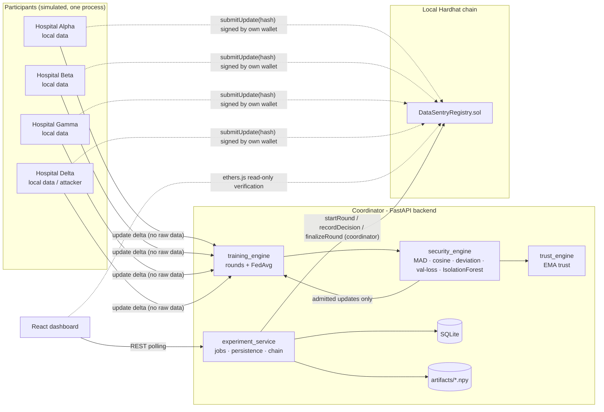

# DataSentry architecture

## Components



## One communication round

1. Coordinator calls `startRound(experimentId, n)` on-chain and stores the
   starting global model (`global_before.npy`).
2. Each hospital trains locally (2 epochs, Adam, CE loss) on its private
   partition and returns `delta = local - global`. Hospital Delta applies the
   configured attack when enabled.
3. Each update is hashed (SHA-256 over the DSv1 serialisation, below) and
   the **hospital's own wallet** calls `submitUpdate(roundId, hash)`.
4. The security engine scores all updates of the round (relative to each
   other) and decides ACCEPT / SUSPICIOUS / REJECT.
5. The coordinator records each verdict on-chain with
   `recordDecision(roundId, participant, riskBps, decision, included)`.
6. FedAvg aggregates admitted updates only (REJECT never; SUSPICIOUS
   down-weighted by default). The new global model is evaluated on the test set.
7. `finalizeRound(roundId, globalModelHash)` closes the round; the contract
   refuses to finalize while any submitted update is undecided.

## Security engine

| Feature | Computation | Normalisation to [0,1] |
|---|---|---|
| Norm anomaly | L2 norm **per local optimizer step** (corrects quantity skew) | robust z (MAD, floored at 15 % of median), ramp z∈[1.5, 5] |
| Cosine disagreement | cosine vs. coordinate-wise median of the *other* updates | cos ≥ 0.5 → 0, cos ≤ −0.5 → 1 |
| Weight deviation | ‖Δᵢ/stepsᵢ − median(others)‖ | robust z, same ramp |
| Validation impact | val loss of (global + Δᵢ) vs. median candidate loss | 1 − exp(−relative increase / 0.5) |
| Update anomaly | Isolation Forest over the four normalised features (≥ 6 history vectors) | s ∈ [0.5, 0.75] → [0, 1] |

`Risk = 0.35·norm + 0.30·cosine + 0.20·deviation + 0.15·validation`.
Thresholds: `< 0.40` ACCEPT, `≥ 0.70` REJECT, otherwise SUSPICIOUS
(configurable). The Isolation Forest can only escalate ACCEPT → SUSPICIOUS
when the rule risk is already ≥ 0.25; it never rejects on its own. With
fewer than 3 updates in a round, MAD-based features are disabled (fallback).

Why per-step norms: with the Dirichlet split, Hospital Gamma has 188 samples
and Alpha 42, so Gamma takes 4× more optimizer steps and naturally moves
further. Raw norms flagged Gamma as SUSPICIOUS in one calibration run; per-step
normalisation removed every honest-client false positive in our measurements.

## Hash serialisation (DSv1)

```
b"DSv1"
for name, tensor in state_dict order (fc1.weight, fc1.bias, fc2.weight, fc2.bias, fc3.weight, fc3.bias):
    uint32 LE len(name) | name utf-8 | uint32 LE ndim | uint32 LE dims... | float32 LE values (row-major)
hash = "0x" + sha256(bytes).hexdigest()
```

Client hashes cover the update delta; global hashes cover the global
parameters. Artifacts are saved under `backend/data/artifacts/<experiment>/round_<n>/`,
and `GET /api/updates/{id}/verify` recomputes the hash from the file and
compares it with SQLite and the on-chain record. Reproduce manually:

```python
import numpy as np
from models.neural_network import create_model, get_params, unflatten, hash_params
template = get_params(create_model(0))
print(hash_params(unflatten(np.load("data/artifacts/<exp>/round_1/hospital_delta.npy"), template)))
```

## Smart contract roles

* **coordinator** (deployer, Hardhat account #0): `registerParticipant`,
  `setParticipantActive`, `startRound`, `recordDecision`, `finalizeRound`,
  `transferCoordinator`.
* **participant** (registered, active wallet; accounts #1–#4): `submitUpdate`
  for itself only (msg.sender is the participant - it cannot submit for others).

Validation (custom errors): unauthorised caller, zero address, empty name,
duplicate registration, zero hash, risk > 10 000 bps, `Decision.None`, duplicate
submission, decision without submission, double decision, finalisation with
pending decisions / empty round / closed round. A REJECT that is still
aggregated (undefended baseline runs) is recorded truthfully and additionally
emits `VerdictOverridden`, making such coordinator behaviour publicly visible.

## Persistence

SQLite tables: `clients`, `experiment_results`, `training_rounds`,
`model_updates`, `security_analysis`, `trust_history`,
`blockchain_transactions`. Every attempted transaction is stored with status
`confirmed` (receipt status 1) or `failed` (+ error) - failures are also shown
as job warnings in the UI. Results survive backend restarts; a job running
during shutdown is marked `interrupted` on next start.
